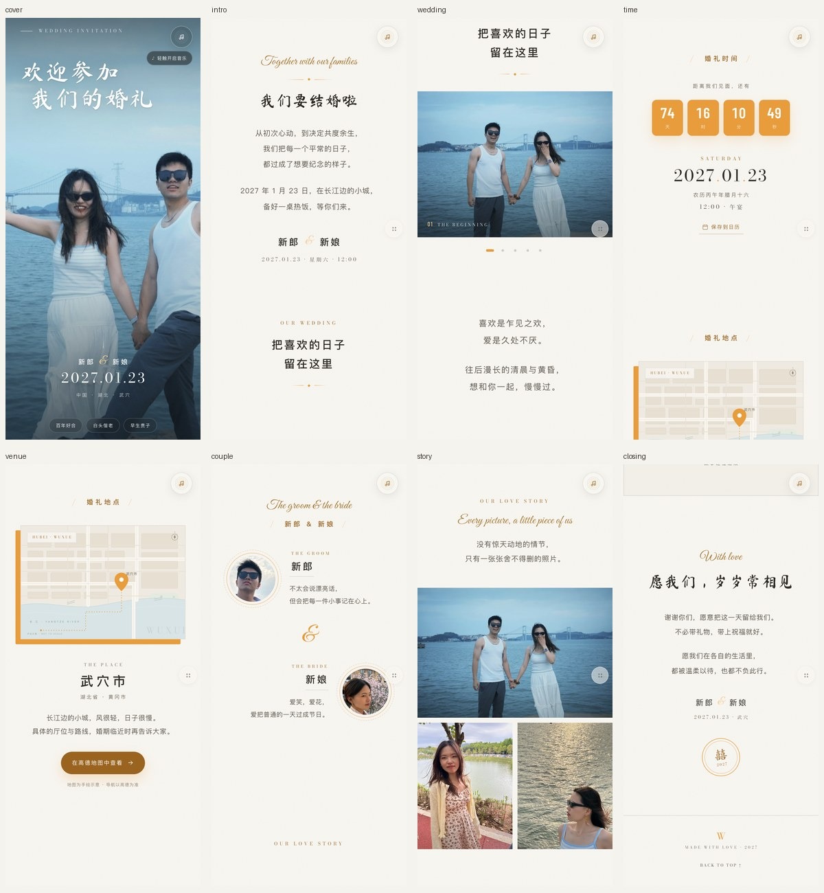

# 婚礼邀请函 · 静态单页



一个可直接部署到 **GitHub Pages** 的婚礼请柬网页。视觉依据同目录的《婚礼季分享风格设计分析报告》复刻：纸感素底、暖橙金单点缀色、四层字体体系、满幅竖版封面、手写标题、大留白与轻动效。

- 单页纵向长滚动，无路由、无后端、无构建步骤
- 打开页面会尝试自动播放音乐；被浏览器策略拦截时，首次触摸/点击即可开始
- 打开页面会按恒定速度自动下滑；速度在代码中配置，打断后 2 秒自动继续
- 所有图片 / 字体 / 音乐均自托管，不依赖 CDN，不热链
- 按报告 §5.1、§7.2 裁撤了礼物、点赞、送礼金、弹幕与宾客回执
- 整站约 **3.4 MB**（图片 2.1 MB + 音乐 1.0 MB + 字体 42 KB + 预览图）

---

## 一、本地预览

在项目根目录执行：

```bash
python3 -m http.server 8000
```

然后打开 <http://127.0.0.1:8000/>。

> 请用本地服务器预览，不要直接双击 `index.html`。`file://` 协议下字体和图片的相对路径可能被浏览器拦截。

---

## 二、页面结构

| 版块 | 内容 | 对应报告 |
|---|---|---|
| 封面 | 满幅竖版婚照 + 白色手写两行标题 + 底部祝福胶囊 | §1.2 模式 A、§4.3 亮点 1 |
| 邀请语 | 英文花体 + 手写「我们要结婚啦」+ 邀请文案 + 新人姓名 | §1.4 字体层级 |
| OUR WEDDING | 4:3 满宽轮播，自动播放 + 手指滑动 + 指示点 | §2.1 |
| 短诗 | 居中诗行，大留白 | §1.4、§4.2 |
| 婚礼时间 | 橙金倒计时 + 日期 / 星期 / 农历 / 午宴 + 加入日历 | §1.5、§5.2 |
| 婚礼地点 | 手绘地图 + 橙金错位相框 + 高德导航按钮 | §1.5、§4.3 亮点 3、§7.2 |
| 新郎 & 新娘 | 圆形头像左右交错 + 一句人物描述 | §1.1 第 7 条 |
| OUR LOVE STORY | CSS Grid 马赛克照片墙 + 点击放大灯箱 | §2.1、§2.3 |
| 结尾 | 手写金句 + 致辞 + 签名 + 囍字印章 | §1.1 第 9 条 |
| 自动下滑 | 打开后按恒定平均速度向下滚动；被打断后 2 秒自动继续，无控制按钮 | 本次新增需求 |
| 悬浮件 | 右上角旋转音符；桌面为时间 / 地点 / 故事 / 更多四按钮，手机收拢为一个「更多」入口 | §2.2、§3、§5.2 |

交互细节：滚动入场（IntersectionObserver）、轮播自动播放与手势、照片灯箱（支持键盘与滑动）、背景音乐（自动播放尝试 + 首次触摸兜底）、自动下滑（打断后 2 秒自动继续）、分享 / 复制链接、返回顶部、`prefers-reduced-motion` 降级。

---

## 三、如何改成你们自己的

所有内容都是静态 HTML，**不需要构建**。改完保存、刷新即可。

### 1. 新人姓名

在 `index.html` 中搜索并替换：

- `新郎` / `新娘`（封面、邀请语、人物介绍、结尾、`<title>`、`og:title`）
- `assets/wedding.ics` 里的 `SUMMARY` 与 `DESCRIPTION`
- `assets/images/og-cover.jpg` 里的「新郎 & 新娘」是**图片上的字**，如需同步修改，编辑 `tools/build_images.py` 中 `build_og()` 的 `d.text(...)` 后重新生成（见第 6 节）

### 2. 婚礼日期

日期在页面里出现了多次，建议按下面的字符串逐个搜索替换：

| 位置 | 现在的内容 | 说明 |
|---|---|---|
| 封面 / 结尾 / 侧边小字 | `2027.01.23`、`2027 · 01 · 23` | 展示用 |
| 邀请语 / 时间版块 | `2027 年 1 月 23 日` 等 | 中文展示 |
| 时间版块 | `SATURDAY`、`星期六` | 星期几 |
| 时间版块 | `农历丙午年腊月十六` | 农历，需按新日期重新查 |
| 倒计时 | `data-target="2027-01-23T12:00:00+08:00"` | **倒计时唯一数据源**，ISO 时间 + 时区 |
| 日历文件 | `assets/wedding.ics` | `DTSTART` / `DTEND` / `DTSTAMP` / `SUMMARY` |
| 页脚 / 印章 | `2027` | 年份 |

农历可以用任意农历转换工具查（注意 2027-01-23 属于丙午年腊月，不是丁未年正月）。

### 3. 婚礼地点

搜索 `武穴`、`黄冈市`、`湖北省`、地图上的 `WUXUE` / `HUBEI`，替换为你们的城市与场地。高德导航链接在 `index.html` 的 `.venue__info` 里：

```html
https://uri.amap.com/search?keyword=%E6%AD%A6%E7%A9%B4%E5%B8%82&city=...
```

`keyword` 是 URL 编码后的地点名。修改后记得把中文重新编码，或直接换成高德分享出来的链接。

地图是内联 SVG 手绘示意，不依赖任何地图 API / key。橙色偏移相框由 `.map-frame__offset` 实现，可复用到任意图片。

### 4. 背景音乐

直接覆盖 `assets/audio/bgm.mp3` 即可，文件名保持不变，页面无需改代码。

- 页面加载后会先尝试自动播放；**带声音的自动播放受浏览器策略限制**，Chrome / Safari / iOS 首次访问通常会拦截
- 被拦截时，音乐按钮下方会出现「轻触开启音乐」；首次点击、触摸、按键或滚轮时自动补播
- 右上角音符按钮可随时暂停/继续；默认音量 48%
- 想改成“只手动播放”：把 `assets/js/main.js` 顶部的 `AUTO_MUSIC.enabled` 改成 `false`
- 想换播放器行为，改 `assets/js/main.js` 里 `audio.volume` 与 `toggleMusic()`
- 现在的 `bgm.mp3` 由 `tools/build_audio.py` 合成（柔和音乐盒 / 毛毡钢琴质感），可以自由替换

### 5. 自动下滑

页面加载后（封面停留约 2.6 秒）会以**恒定平均速度**向下滚动。

默认配置在 `assets/js/main.js` 顶部：

```js
var AUTO_SCROLL = {
  enabled: true,
  speed: 30,          // 平均速度：像素/秒（只在这里配置）
  delay: 2600,        // 封面停留：毫秒
  resume: 2000        // 被打断后多久继续：毫秒
};
```

- `speed` 是每秒滚动的像素数，不是“每屏秒数”；整页约 8000px，30px/s 大约 4 分钟走完
- **「更多」面板里不再有自动下滑配置**，速度、开关、延迟、恢复间隔都改上面这段代码
- 手动滑动、打开「更多」/照片灯箱、切到后台标签页都会暂停；**打断结束后 2 秒自动继续，不弹提示**
- 页面没有自动下滑控制按钮；要彻底停止只能关闭页面，或把 `AUTO_SCROLL.enabled` 改成 `false`
- 滚到底部自动结束，不再提示；重新打开页面会从顶部开始
- 系统开启 `prefers-reduced-motion` 时默认不自动滚动
- 关闭默认自动下滑：把 `AUTO_SCROLL.enabled` 改成 `false`

### 6. 更换照片

1. 把新照片放进 `myPhotos/`（该目录已在 `.gitignore` 中排除，不会进公开仓库）
2. 打开 `tools/build_images.py`，修改顶部 `FILES` 映射（键 `"01"`–`"23"` 对应照片）
3. 在 `story`、`carousel`、`cover` 列表里调整用图与裁切锚点
4. 运行：

```bash
python3 tools/build_images.py
```

脚本会自动完成：EXIF 方向校正 → Display P3 转 sRGB → 按比例裁切 → 轻微锐化 → WebP 压缩 → **剥离 EXIF / GPS**。

> 这三个工具脚本只在你重新生成资源时才需要：`build_images.py` 需要 Pillow；`build_audio.py` 需要 numpy、scipy 和 ffmpeg；`build_fonts.py` 需要 curl 和网络。页面本身运行时不依赖它们。

如果换图后画面主体变了，记得同步修改 `index.html` 中每张图的 `alt` 文案。

### 7. 手写字体缺字

中文手写体只打包了页面实际用到的字（约 19 个），所以文件只有 8 KB。如果你改动了**手写体**文案（封面标题、`我们要结婚啦`、结尾金句、`囍`），新字可能会显示成系统楷体。

处理方法：编辑 `tools/build_fonts.py` 顶部的 `HAND_TEXT`，把新文案里的字都加进去，然后运行：

```bash
python3 tools/build_fonts.py
```

英文花体 / 衬线体已包含完整大小写字母与数字。字体全部为 SIL OFL 协议，授权原文在 `assets/fonts/licenses/`。

### 8. 分享卡片（微信 / 社交平台）

- `og-cover.jpg` 已生成（1200×630），用于链接预览
- 分享图里的标题、日期、地点、姓名是**烘焙进图片的**：改完文案后请重跑 `python3 tools/build_images.py`，或直接替换这张图
- 部署后，把 `index.html` 里的相对路径改成完整地址，否则部分平台抓不到图：

```html
<meta property="og:image" content="https://你的用户名.github.io/仓库名/assets/images/og-cover.jpg">
```

微信内自定义分享标题 / 缩略图需要服务端签名，纯静态部署无法实现，只能使用默认链接卡片（报告 §7.2 第 4 条）。

### 9. 搜索引擎收录

页面默认加了 `<meta name="robots" content="noindex, nofollow">`，避免私人照片与姓名被搜索引擎收录。如果希望公开被搜到，删掉 `index.html` 里的这一行即可。

### 10. 加入日历

`assets/wedding.ics` 已写好 2027-01-23 12:00–15:00（Asia/Shanghai）的事件，并带提前 3 小时的提醒。改日期时同步修改该文件。

---

## 四、部署到 GitHub Pages

### 方式 A：直接发布分支（最简单，推荐）

1. 新建一个 GitHub 仓库（公开或私有都可以；私有仓库的 Pages 需要付费计划）
2. 把本项目推到 `main` 分支（`myPhotos/` 已被忽略，不会上传）：

   ```bash
   git init
   git add .
   git commit -m "婚礼邀请函"
   git branch -M main
   git remote add origin git@github.com:你的用户名/仓库名.git
   git push -u origin main
   ```

3. 仓库 **Settings → Pages → Build and deployment**
   - Source：`Deploy from a branch`
   - Branch：`main`，目录：`/ (root)`
4. 等 1–2 分钟，访问 `https://你的用户名.github.io/仓库名/`

根目录已放好 `.nojekyll`，避免 Jekyll 处理静态资源。

> 如果仓库名是 `你的用户名.github.io`，访问地址就是 `https://你的用户名.github.io/`。
> 如果仓库名是 `wedding`，地址是 `https://你的用户名.github.io/wedding/`。所有资源都是相对路径，无需改配置。

### 方式 B：GitHub Actions 自动发布

仓库已包含 `.github/workflows/pages.yml`。

1. **Settings → Pages → Source** 选择 `GitHub Actions`
2. 推送 `main` 分支，或在 Actions 页手动运行 `Deploy to GitHub Pages`
3. 工作流会把整个站点打包并发布

默认监听 `main` 分支。如果你的默认分支叫 `master`，把 `pages.yml` 里的 `branches: [main]` 改掉。

### 部署后自检

- [ ] 手机 390×844 下封面标题不挡脸、祝福胶囊只出现在封面底部
- [ ] 轮播能自动播放，也能手指左右滑动；指示点跟随
- [ ] 点击照片墙能打开灯箱，左右切换、Esc 关闭
- [ ] 倒计时数字正确（时区是 UTC+8）
- [ ] 打开页面后音乐能自动播放；被浏览器拦截时，轻触任意位置能开始播放
- [ ] 自动下滑按设定速度进行；手动滑动/打开面板后约 2 秒自动继续
- [ ] 右上角音乐按钮能暂停/继续
- [ ] 「在高德地图中查看」能打开高德
- [ ] 「保存到日历」能下载 `.ics`
- [ ] 「更多 → 分享」能唤起系统分享或复制链接
- [ ] 微信内打开时，封面与正文不白屏（GitHub Pages 域名有被拦截风险，见下）

---

## 五、目录结构

```
.
├── index.html                  # 单页全部结构
├── assets/
│   ├── css/
│   │   ├── fonts.css           # 自动生成，勿手改
│   │   └── style.css           # 全部样式
│   ├── js/
│   │   └── main.js             # 全部交互，无依赖
│   ├── images/                 # 由 tools/build_images.py 生成
│   ├── fonts/                  # 字体子集 + OFL 授权
│   ├── audio/bgm.mp3           # 背景音乐
│   └── wedding.ics             # 日历文件
├── docs/preview.jpg            # README 的页面预览图
├── tools/
│   ├── build_images.py         # 照片批处理
│   ├── build_fonts.py          # 字体子集
│   └── build_audio.py          # 背景音乐合成
├── .github/workflows/pages.yml # 可选：Actions 发布
├── .nojekyll
├── LICENSE
└── README.md
```

`myPhotos/` 是本地原图目录，默认不提交。如果希望原图也进仓库（例如私密仓库），删掉 `.gitignore` 里的 `myPhotos/` 一行即可；公开仓库不建议，原图可能含 EXIF / GPS 信息。

---

## 六、技术说明

- **无框架、无构建**：原生 HTML / CSS / JS，GitHub Pages 直接托管
- **轮播**：CSS Scroll Snap + 少量 JS（自动播放、循环、指示点、键盘），没有为了一个轮播引入 Swiper
- **入场**：IntersectionObserver 添加 `.is-in`，CSS 过渡完成；`prefers-reduced-motion` 下全部直接显示
- **自动下滑**：requestAnimationFrame + 恒定 px/s；手动/面板/后台打断后 2 秒自动继续；无控制按钮；速度只在代码配置；减弱动效下默认关闭
- **自动播放**：先尝试 `audio.play()`；被策略拦截后监听首次手势补播，并显示轻提示
- **字体**：Ma Shan Zheng（中文手写）、Great Vibes（英文花体）、Bodoni Moda（英文细衬线）、Barlow Condensed（数字），全部自托管并按实际用字子集化
- **图片**：WebP，单张约 14–211 KB，懒加载，封面预加载
- **无外部请求**：页面加载阶段不请求任何第三方域名；只有点击「高德导航」才会跳转外链
- **无障碍**：语义化 section / h1-h3、图片 alt、按钮 aria-label、灯箱与面板使用原生 `<dialog>`、键盘方向键切换照片、可见焦点样式
- **兼容性**：iOS Safari 15.4+、Chrome / Edge / Firefox 现代版本。`<dialog>` 不支持时，面板与灯箱不会弹出，但页面主体仍可正常浏览

---

## 七、版权与隐私

- **代码**：MIT（见 `LICENSE`）
- **照片**：版权归新人所有，不在 MIT 授权范围内；`myPhotos/` 默认不进仓库，生成的 WebP 已剥离 EXIF / GPS
- **字体**：SIL Open Font License，授权原文见 `assets/fonts/licenses/`
- **音乐**：由 `tools/build_audio.py` 合成，可自由使用

---

## 八、一个必须知道的现实问题

报告 §7.4「提醒 1」同样适用：

> GitHub Pages 在中国大陆访问不稳定，且 `*.github.io` 域名有被微信拦截分享链接的风险。

请柬主要靠微信转发。如果这是真实要发给亲友的页面，建议：

- **GitHub 只做源码仓库与 CI**
- **实际访问用 Cloudflare Pages / Vercel + 自有域名**（国内备案域名体验最佳）

换到 Cloudflare Pages 时，直接连这个仓库、构建命令留空、输出目录填 `/` 即可，代码不用改。若坚持只用 GitHub Pages，请接受微信内可能打不开的现实。
